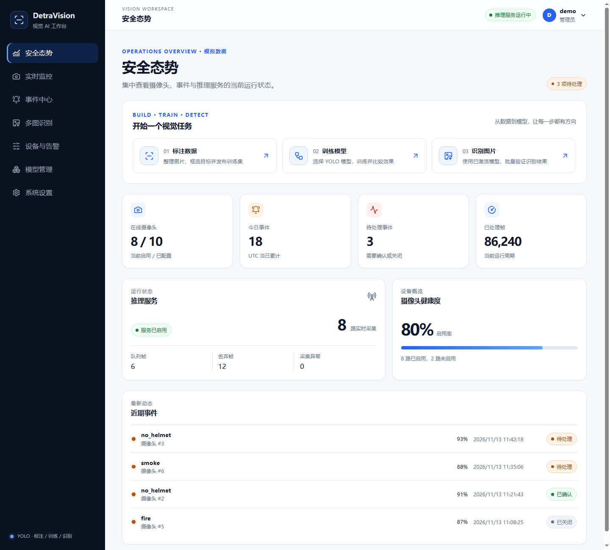
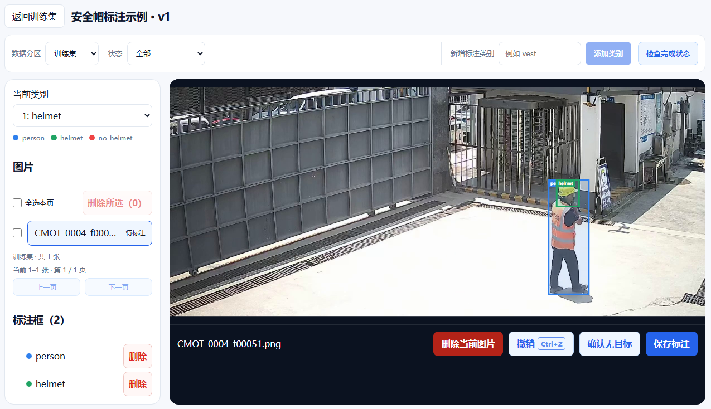
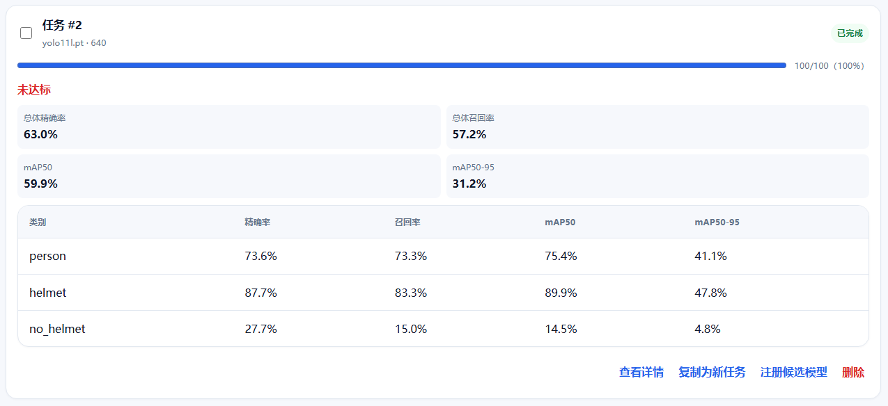
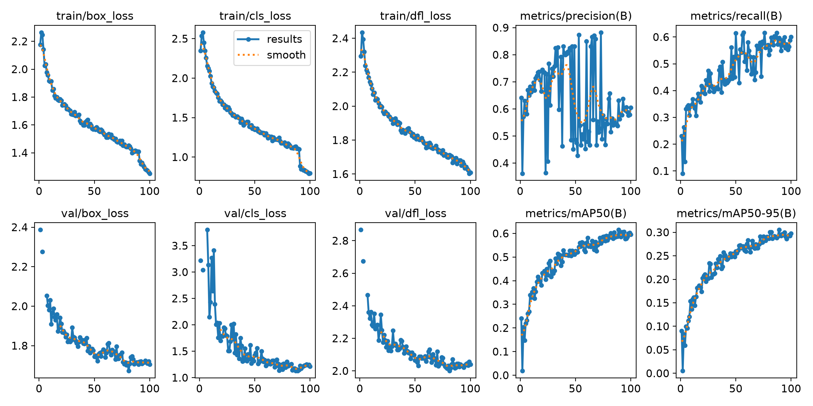
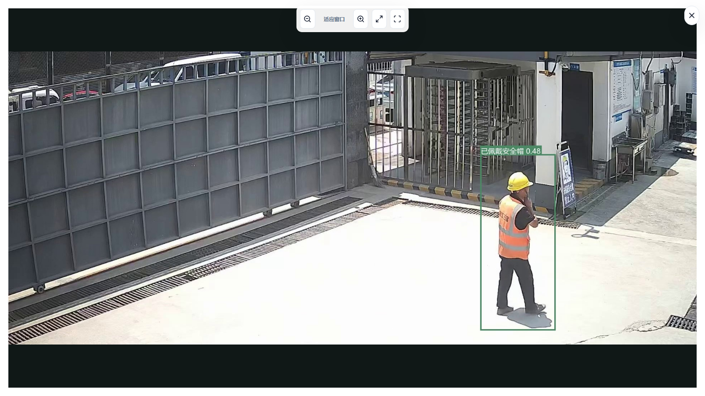

+++
title = "DetraVision 基于 YOLO 的通用目标检测与训练平台"
slug = "detravision"
categories = ["projects"]
date = 2026-11-13T08:00:00+08:00
description = "把数据标注、数据集版本、本地 YOLO 训练和图片、视频识别放在同一工作台，用安全帽样本展示实际操作、训练指标和识别结果。"
keywords = ["DetraVision", "YOLO", "目标检测", "安全巡检", "数据标注", "模型训练"]
clearReading = true
showSocial = false
showPagination = true
showTags = true
showDate = true
+++

给一张图片画出检测框不难。换到现场摄像头，问题会具体得多：远处的人头只有几个像素，安全帽被遮住一半，夜间画面和白天差了不少。模型报错以后，还得找到原图、补标注、重新训练，再确认新模型有没有把原来能识别的样本弄丢。

[DetraVision](https://github.com/ThinkMo/detravision) 是我做的一个开源目标检测工作台。我把图片标注、数据集版本、本地 YOLO 训练、效果评估和识别放进同一个网页，安全巡检是其中一个应用场景。它省下的是在几套工具和一堆模型文件之间来回找的工夫，识别效果仍然要靠数据和测试说话。

<!--more-->



*工作台界面演示。摄像头数量、事件记录、处理帧数和运行状态均为模拟数据，仅用于展示界面，不代表实际部署规模或性能。*

## 以施工现场的安全帽检测为例

施工现场的安全巡检，是目标检测的一个常见应用。摄像头拍到了人员，不等于能看清安全帽佩戴状态；模型发现疑似问题，也还需要有人复核。下面用这个场景串起标注、训练和识别的操作，不涉及具体单位或项目。

如果从安全帽检测这个小任务开始，我会先问几个问题：要看的是哪个区域？人离摄像头有多远？哪些画面能够判断佩戴状态，哪些根本看不清？发现疑似问题以后，谁来复核？这些问题没定下来，先选一个更大的模型，往往也不知道该拿什么判断它好不好。

在这个场景里，DetraVision 负责数据标注、模型训练和视觉检测。可以先拿一批有使用授权的现场图片，把标注、训练、测试跑通，再决定是否接入实时视频。

## 先把图片和标注管清楚

安全帽示例用了三个类别：`person`、`helmet`、`no_helmet`，分别标完整人员、佩戴安全帽的头部、未佩戴安全帽的头部。

这里有个容易省错的步骤：**检测到人，却没检测到安全帽，不能直接算作没戴安全帽。** 也可能是头部被挡住了、背对镜头，或者画面太糊。`no_helmet` 需要明确的标注和模型判断，不能靠另外两个结果相减得来。

在训练集页面，可以创建编辑版本，逐张框选目标、删除错误框、撤销操作。没有目标的背景图也能保留，但要明确点“确认无目标”。它和“还没来得及看这张图”是两回事。



*用 [CMOT 数据集](https://github.com/XZ-YAN/CMOT-Dataset)的 `CMOT_0004_f00051` 视频帧演示标注，蓝框是 person，绿框是 helmet。框线是在截图副本中添加的操作示例，未写回原始训练集，也不代表标签已通过核验。图片来源为 XZ-YAN / CMOT-Dataset，采用 CC BY-NC 4.0 许可。*

标注完成后先校验，再发布为只读版本。后续补图或修改标签，从已有版本创建新的编辑版本，不直接改掉旧数据。这样下次训练变好了或变差了，至少能说清楚两次用了哪批图片。

现场取图也别只挑清楚、好标的画面。远景、遮挡、背光、夜间和无人背景都值得留一些。训练集和测试集则要分开，尤其不要把同一段视频的相邻帧随机分到两边；模型见过几乎一样的画面，分数好看也说明不了多少问题。

类别不限定为安全帽。项目支持自定义矩形框目标检测，也可以为车辆、反光衣等目标准备自己的数据；但换了类别就要重新准备标注、训练和验证，并不是在页面里加一个名字就能识别。

## 训练跑完了，还要知道错在哪里

发布数据集以后，可以在网页里创建本地 YOLO 训练任务，选择基础权重、输入尺寸、训练轮数、batch 和设备。基础模式保留常用配置，高级模式再调整学习率、增强等参数。权重文件需要提前准备，页面列出模型名称不等于服务器上已经有模型。

我更关心训练结束以后能留下什么。每次任务会记录数据集快照、类别和训练配置；使用同一份数据集快照的实验可以并排比较，不必靠文件夹名字猜 `best.pt` 是哪一次跑出来的。



*这是本地保存的一次 100 轮训练记录，任务已经结束，但验收未通过。helmet 和 no_helmet 的效果差距很大，问题在逐类指标里看得更清楚。*

评估除了总体分数，也会列出各类别的 precision、recall、mAP，以及误检、漏检和相关曲线。对安全帽任务来说，总体分数高，不代表 `no_helmet` 这一类就可用：

- 漏掉了多少真正没戴安全帽的人，要看这一类的召回率和漏检样本。
- 报出来的问题里有多少是误报，要看精确率，并回到图片上确认。
- 调低置信度可能少漏一些，也可能多报很多，不能只看某一个数字。

页面提供的建议置信度，是从测试集结果里算出的调参起点，不是现场通用答案。换了摄像头角度、光照和距离，还要重新检查。项目里可配置的验收门槛也只是门槛，不是已经达到的成绩。



*同一次训练保存的曲线。损失在下降，precision 却仍有明显波动；只看“训练完成”或最后一轮的数字，会漏掉这些信息。曲线中的验证指标与任务卡片中的测试结果也不能混为一谈。*

训练可以请求停止；保存了有效 checkpoint 的任务支持继续训练，并保留原来的任务记录。想改学习率或增强策略，则复制任务做新实验，别把改参数和续训混在一起。

## 先试图片，再接摄像头

训练产物可以注册成候选模型，确认来源和评估结果后再激活。我建议先用“多图识别”检查一批没有参与训练的图片：一次最多 20 张，能预览检测框，也能下载结果。先看它在容易出错的画面上怎么表现，比直接挂上摄像头更方便排查。



*与标注页使用同一张 CMOT 视频帧。这里是本地已有模型的真实识别结果，绿色框显示“已佩戴安全帽”，置信度约 48%；上图为结果的放大预览。这个分数不是准确率，单张示例也不能替代独立测试或现场验收。*

实时部分支持多路 RTSP 视频和 ROI，也就是只关注画面中的指定区域。内置事件处理有连续帧确认、冷却去重，避免一个目标连续出现时反复刷出同类告警；事件可以查看抓拍、确认和关闭，也支持飞书通知。

这些功能解决的是“检测结果怎么交给人处理”，不等于风险已经处置完成。谁负责看告警、多久复核、误报怎么记录，仍然需要现场确定。视觉检测应当辅助巡检，不能替代人员判断和原有安全措施。

还有一个使用边界需要单独说：**支持自定义类别训练和识别，不等于支持任意类别的实时告警规则。** 安全帽违规、明火和烟雾有内置业务示例，通用的规则编辑器还没做。像越界、停留时间、多人行为关联这类需求，不能仅凭模型能画框就算完成。

## 想试一下，先在本机跑起来

项目后端用 FastAPI，前端用 React 和 TypeScript，训练与推理基于 Ultralytics YOLO。支持 Windows 和 Linux；本地试用使用 SQLite，生产配置要求 MySQL。当前更适合本地验证和可信内网的单机部署，没有给出固定的摄像头并发承诺，要按模型、分辨率和实际硬件测试。

准备 Python 3.12+ 和 Node.js 24.x，拉取代码：

```bash
git clone https://github.com/ThinkMo/detravision.git
cd detravision
```

Windows 执行：

```powershell
.\start.cmd
```

Linux 执行：

```bash
chmod +x start.sh
./start.sh
```

启动脚本会准备依赖、构建前端并启动服务，浏览器打开 <http://127.0.0.1:8000/>。没有模型也能先看工作台；真正做识别和训练，需要另外准备兼容的模型权重和数据集。首次安装需要下载依赖，不能把本地部署理解成首次启动就能完全离线。

详细的环境配置、登录说明和 GPU 设置放在仓库的[部署与使用指南](https://github.com/ThinkMo/detravision/blob/main/docs/operations.md)，标注和训练也有各自的操作文档。开发默认账号只用于本地试用，不要把开发配置直接暴露到公网。

自动标注还在调研，云上训练还在规划，当前能执行的是本地训练。项目采用 AGPLv3，做二次开发或提供网络服务前，需要一起核对项目、Ultralytics 和所用模型权重的授权条件。

如果手头已有摄像头和一个明确的检测目标，可以先从一批图片开始：标清楚、留出测试集、跑一个基线，然后把误检和漏检的图找出来。DetraVision 先把这些重复工作放到了一处，后面该补数据、换模型，还是调整摄像头，就有了具体依据。

项目代码：[ThinkMo / detravision](https://github.com/ThinkMo/detravision)。有使用问题或具体的场景建议，可以在仓库里提 Issue；涉及现场画面时，请先确认授权并做好脱敏。
