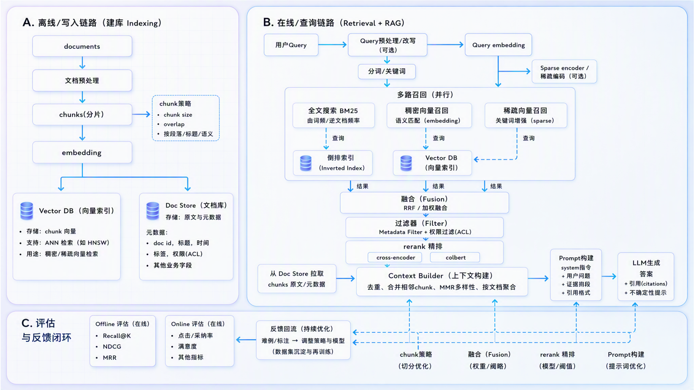
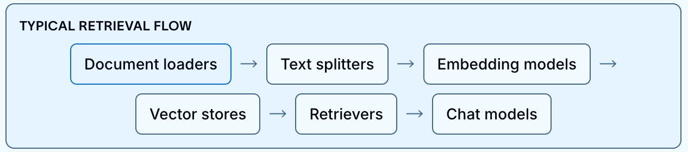
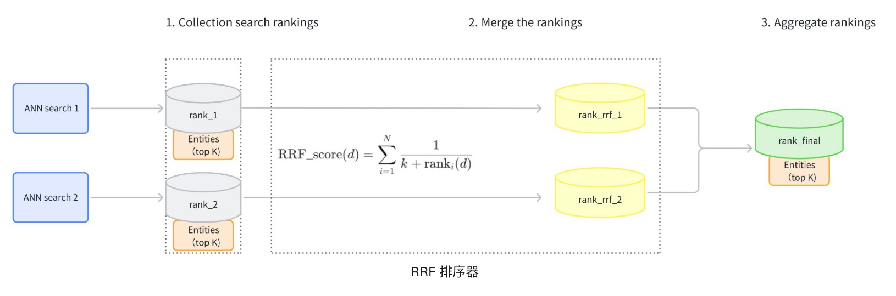

+++
keywords = ["RAG"]
title = "RAG System"
categories = ["llm"]
disqusIdentifier = "rag"
comments = true
clearReading = true
date = 2026-11-27T10:31:44+08:00 
showSocial = false
showPagination = true
showTags = true
showDate = true
+++

# RAG System

现在是2026年11月27日，随着模型能力的不断增加，“RAG已死”的论调越来越多，而**我的观点恰恰相反**；RAG System这种通过检索-增强上下文的系统永远不会消失，原因之一是用来训练大模型的语料、数据都来自公开的互联网内容，而这部分公域数据仅仅占整体数据量的4%，存储在内部系统、需授权访问或无法公开获取的数据占到整体数据量的96%，使用AI能力处理这部分内容时就需要对应的私域数据补充上下文；原因之二是记忆，当前记忆系统的实现比如zep、mem0等存储、召回记忆使用的技术与RAG System系统如出一辙；从[arxiv](https://arxiv.org/)上检索RAG相关的论文，仅仅11月就有125篇相关论文发表，可见掌握这一技术的必要性，本文着重梳理RAG System中的关键技术，希望可以抛砖引玉。

## 概览



RAG系统可以分为离线数据写、在线查询、评估与优化三部分；离线数据写入主要包括：文档预处理、分片、存储，涉及到各种文档类型处理，适合系统的分片方式以及向量数据库存储、索引选择等；在线查询主要包括：查询优化、多路检索、融合、过滤、重排以及生成；评估与优化主要包括：检索、召回、生成各个阶段指标评估、归因与优化。下面会展开各个阶段进行分析。

## 离线写入

离线写入这部分结合langchain + milvus进行阐述，典型的流程如langchain intergrations中所示：




### 文档预处理

针对不同类型的文档，比如pdf、html、markdown等，langchain intergrations提供了各种[Document Loaders](https://docs.langchain.com/oss/python/integrations/document_loaders)来处理并加载文档内容，比如Unstructured、Docling。加载完成后可以对Document增加一些文档相关的metadata，帮助后边做权限过滤等。

```Python
from langchain_unstructured import UnstructuredLoader

file_paths = [
    "./example_data/layout-parser-paper.pdf",
    "./example_data/state_of_the_union.txt",
]


loader = UnstructuredLoader(file_paths)
raw_docs = loader.load()

# 为加载后的原始文档注入元数据（如部门、文档类型）
custom_meta = {"department": "HR", "doc_type": "policy", "version": "1.0"}
for doc in raw_docs:
    doc.metadata.update(custom_meta)
```


### 分片

下一步是对加载好的文档进行分片处理，langchain提供了 [RecursiveCharacterTextSplitter](https://docs.langchain.com/oss/python/integrations/splitters/recursive_text_splitter)来应对绝大多数的场景。

```Python
from langchain_text_splitters import RecursiveCharacterTextSplitter

text_splitter = RecursiveCharacterTextSplitter(chunk_size=1000, chunk_overlap=0)
texts = text_splitter.split_text(document)
```

#### 分片大小与分片策略

**Chunk 大小：**

- **小 chunk**：检索精度高（向量更聚焦），但上下文割裂，生成时信息不足。
- **大 chunk**：上下文完整，但向量被"稀释"，噪声多、召回精度下降，且耗费更多 token。
- **实践折中**：「小块检索、大块上下文提供给 LLM」—— 即 small-to-big / parent-child：用小 chunk 做向量匹配，命中后回溯其父块或前后邻块作为生成上下文，再配合 chunk 间 **overlap（如 10~20%）** 缓解边界切断。


**分片策略**

| 策略 | 适用 | 取舍 |
|---|---|---|
| 固定长度切分 | 通用、实现简单 | 会切断语义，表格/代码/列表被腰斩 |
| 按结构切分（标题/段落/Markdown/HTML） | 结构化文档 | 需要高质量解析器，chunk 大小不均 |
| 语义切分（相邻句 embedding 相似度断点） | 长连续文本 | 计算成本高 |
| 父子/小-大切分（small-to-big） | 问答精准 + 上下文完整 | 索引与存储复杂度上升 |


**元数据**同样关键：切分时保留 `标题路径 / 页码 / 来源 / 时间`，既能做过滤检索，也能在生成时产出可追溯引用。


### 存储

#### Embedding models

Embedding models将切分好的文档chunks转化为固定长度的向量，向量保存了切片文档的语义，可以通过余弦相似度、欧几里得距离、点积等方式可以检索到相关语义的内容。

如何选择Embedding models呢？可以结合业务情况参考[MTEB](https://huggingface.co/spaces/mteb/leaderboard)榜单，MTEB基准测试涵盖了Embedding models在检索、聚类、分类和重排任务中的表现，可以根据语言和业务场景进行选择，因为是离线处理，在Embedding models的选择上更关注：**向量维度(维度越高表达力越强但存储/检索越贵)、向量长度(Context length分片越长适配更长的向量，提高表达能力)以及多模态支持**。

Langchain中针对Embedding models的支持可以参考[文档](https://docs.langchain.com/oss/python/integrations/embeddings#beyond-single-vector-dense-embeddings)。在使用Milvus作为向量数据库时，需要指定embedding_function，建议使用HuggingFaceEmbeddings本地模型来测试。

```Python
from langchain_huggingface import HuggingFaceEmbeddings

embeddings = HuggingFaceEmbeddings(
    model_name="intfloat/e5-large-v2",
)

vector_store = Milvus(
    embedding_function=embeddings,
    ...
)
```

#### 存储

离线处理的最后一步是存储，将处理好的向量与元数据进行构建索引、存储方便在线检索；可选的向量数据库很多，比如Qdrant、Milvus、LanceDB等，它们都支持稠密+稀疏向量；此外为了支持多跳查询、路径推理而生的GraphRAG使用Neo4j等图数据库存储。

这里以Milvus为例进行说明，重点了解向量数据库不同索引结构的实现，参考[官方文档](https://milvus.io/docs/zh/index-explained.md)。

```Python
# 索引参数配置（列表顺序需与 vector_field 的顺序一一对应）
# index_params[0]  -> 对应 "dense"  稠密向量字段
# index_params[1]  -> 对应 "sparse" 稀疏向量字段
index_params = [{
    # ---------- 稠密向量索引配置 ----------
    # 相似度度量方式：COSINE 余弦相似度
    # 适用于文本/图像等 embedding，衡量向量方向相似性
    "metric_type": "COSINE",
    # 索引类型：HNSW（Hierarchical Navigable Small World）
    "index_type": "HNSW",
}, {
    # ---------- 稀疏向量索引配置 ----------
    # 相似度度量方式：BM25 概率检索模型
    # 基于词频与逆文档频率，擅长关键词/全文匹配
    "metric_type": "BM25",
    # 索引类型：AUTOINDEX
    # Milvus 自动根据字段类型与 metric_type 选择最优索引
    "index_type": "AUTOINDEX",
}]

# 构建 Milvus 向量存储实例，混合检索
vector_store = Milvus(
    # 文本嵌入模型：用于把文本转成稠密向量（dense embedding）
    embedding_function=embeddings,
    # 连接参数：uri 指向 Milvus 服务地址（如 http://localhost:19530）
    connection_args={"uri": config.vector_store_uri},
    # 内置 BM25 函数：Milvus 服务端自动把原始文本转为稀疏向量（sparse embedding）
    # 无需外部 embedding 模型，配合上面的 "BM25" + "AUTOINDEX" 使用
    builtin_function=BM25BuiltInFunction(),
    # 向量字段声明：混合检索（Hybrid Search）
    #  - "dense"  稠密向量字段，由 embedding_function 生成
    #  - "sparse" 稀疏向量字段，由 BM25BuiltInFunction 自动生成
    # 两者顺序与 index_params 一一对应
    vector_field=["dense", "sparse"],
    # 主键自动生成（由 Milvus 分配 ID），无需手动传入
    auto_id=True,
    # drop_old=False：如果集合已存在则复用，不删除重建
    # （True 会先删除同名 Collection 再重建，慎用，会导致数据丢失）
    drop_old=False,
    # 传入上面定义的索引参数
    index_params=index_params,
)
```

Milvus支持的索引类型有多种，简单介绍以下几种：

|索引类型|特点|构建|查询|
|----|----|----|----|
|FLAT|准确度高，100%召回率|O(1)|O(n) 依赖于一种 "蛮力 "方法，即直接将每个查询向量与数据集中的每个向量进行比较||
|HNSW|查询快、召回高，但内存占用大、构建慢、不易频繁更新|O(N log N)|O(log N)|
|IVF|内存友好、适合超大规模，但有精度损失（PQ 量化），需调 `nprobe` 平衡速度与召回|O(N × nlist × iters)|O(nprobe × N / nlist)|

##### HNSW(分层可导航小世界模型)

[HNSW](https://milvus.io/docs/zh/hnsw.md) = 可导航小世界图 + 跳表式分层。

**基础 NSW（可导航小世界图）**：每个向量是图上一个**节点**，建图时让每个节点和邻近的若干节点连边。检索时：

1. 从任意入口节点出发；
2. 看当前节点所有邻居，跳到**离 query 最近的那个邻居**；
3. 不断贪心"往更近方向走"，直到当前节点比所有邻居都更接近 query → 局部最优，返回。

就像社交网络找人：从熟人出发，每次跳到"离目标更近的朋友"。问题：只有近距离边时，跨越长距离要走很多步。

**关键改进：分层（Hierarchical）**，借鉴跳表思想建多层图：

```
Layer 2 (最稀疏):  o---------------o            ← 少量节点,长程边,快速粗定位
                   |               |
Layer 1:        o--o----o-------o--o
                |  |    |       |  |
Layer 0 (最密): o-o-o-o-o-o-o-o-o-o-o-o-o        ← 所有节点,短程边,精细定位
```

- **上层稀疏**：节点少、边跨度大，负责**远距离快速逼近**（像坐高速）。
- **下层稠密**：全部节点、边短，负责**近距离精细搜索**（像走小路）。
- **检索**：从最高层入口贪心走到局部最优 → **下沉一层**，以该点为新起点继续 → 直到第 0 层做最终邻居搜索。
- 每个节点分配到哪层**按概率随机**（越高层概率指数衰减），上层天然稀疏。

**关键参数**：

- `M`：每个节点最大邻居数。越大 → 图越密、召回越高，但**内存和构建时间越大**。
- `efConstruction`：建图时候选集大小，越大图质量越高、构建越慢。
- `efSearch`：查询时候选集大小，**越大召回越高、查询越慢**（运行时调速度/精度的旋钮）。

```Python
from pymilvus import MilvusClient

# Prepare index building params
index_params = client.prepare_index_params()

index_params.add_index(
    field_name="your_vector_field_name", # Name of the vector field to be indexed
    index_type="HNSW", # Type of the index to create
    index_name="vector_index", # Name of the index to create
    metric_type="L2", # Metric type used to measure similarity
    params={
        "M": 64, # Maximum number of neighbors each node can connect to in the graph
        "efConstruction": 100 # Number of candidate neighbors considered for connection during index construction
    } # Index building params
)

client.create_index(
    collection_name="your_collection_name",
    index_params=index_params
)
```

##### IVF(倒排文件)

[IVF](https://milvus.io/docs/zh/ivf-flat.md)核心：**先分区，查询时只查相关分区**，避免扫全库。

**建索引（离线）**：

1. 对全部向量跑一次 **K-means 聚类**，得到 `nlist` 个聚类中心（centroid），如 1 万个桶。
2. 每条向量归属到最近中心，挂在该桶下 → 形成"**中心 → 向量列表**"的倒排结构。

**检索（在线）**：

1. query 和 `nlist` 个**中心**算距离（如 1 万次，很便宜）；
2. 选出最近的 `nprobe` 个桶（如 `nprobe=16`）；
3. **只在这些桶内部**做精确距离计算，其余桶全跳过。

```
全库向量 ─K-means→  [桶1][桶2]...[桶10000]
query ─→ 比中心,选最近的 nprobe 个桶 ─→ 只在这些桶里精算
```

**核心取舍 `nprobe`**：

- `nprobe` 小 → 扫桶少 → **快，但可能漏掉"真正最近邻恰好在没被选中的桶里"**（边界问题），召回下降。
- `nprobe` 大 → 扫桶多 → **召回高但变慢**（`nprobe=nlist` 退化成暴力搜索）。
- `nlist`（桶数）配合调：桶多则每桶小、定位精细但中心比对变多。

IVF 有**漏召回的固有风险**（最近邻跨桶），这是它召回通常略低于 HNSW 的根本原因。

```Python
from pymilvus import MilvusClient

index_params = MilvusClient.prepare_index_params()

index_params.add_index(
    field_name="your_vector_field_name", # Name of the vector field to be indexed
    index_type="IVF_FLAT", # Type of the index to create
    index_name="vector_index", # Name of the index to create
    metric_type="L2", # Metric type used to measure similarity
    params={
        "nlist": 64, # Number of clusters for the index
    } # Index building params
)
```

##### SPARSE_INVERTED_INDEX(BM25)

BM25(Best Match 25)适合精确匹配，解决专有名词、编号、代码、罕见词，是信息检索领域最经典的词袋检索排序函数，其公式主要通过以下三个要素决定：

- 词频饱和（TF Saturation）：一个词在文档中出现 10 次，不应该比出现 5 次“相关 2 倍”，收益应该递减。
- 稀有词更重要（IDF）：查询里的“的”几乎每篇都有，区分度低；“量子纠缠”只出现在少数文档，命中它应该大幅加分。
- 长文档惩罚（Length Normalization）：长文档天然更容易包含查询词，不能让它仅凭“篇幅长”就占优。

## 在线检索

### Query侧优化

- **Query 改写/扩展/澄清**：口语化、指代不清的问题直接检索效果差。
- **多查询（Multi-query）**：一个问题生成多个变体并行召回再合并，提高召回率，整体latency、成本会增加。
- **Query 路由**：类似AgenticRAG
，先分类问题（闲聊 / 需检索 / 需结构化查询），避免对不需要检索的问题强行 RAG。

### 多路召回

[多路召回](https://milvus.io/docs/zh/multi-vector-search.md)即多向量混合搜索，其整合了不同的搜索方法：

- 稀疏-稠密向量搜索，稠密向量非常适合捕捉语义关系，而稀疏向量则在精确关键词匹配方面极为有效
- 多模态向量搜索，支持跨多种数据类型（包括文本、图像、音频及其他类型）进行搜索，在多模态RAG方面有较好的搜索体验

针对多路召回的文档数据，可以通过[互逆排名融合（RRF）排名器](https://milvus.io/docs/zh/rrf-ranker.md)进行重排序，它根据结果在不同搜索路径中的排名位置（而非原始相似度得分）来平衡来自多个向量搜索路径的结果。

RRF Ranker 策略的主要工作流程如下：

- 收集搜索排名：收集向量搜索各路径的结果排名（rank_1, rank_2）。
- 合并排名：根据公式将各路径的排名 (rank_rrf_1, rank_rrf_2) 进行转换。计算公式中涉及变量 N，它代表检索结果的数量。ranki(d) 表示第 i 个检索器生成的文档d的排名位置。k是一个平滑参数，通常设置为 60。
- 聚合排名：根据组合排名对搜索结果进行重新排序，以生成最终结果。



```Python
from typing import List, Dict, Tuple
from langchain_core.documents import Document

def coarse_retrieve_rrf(
    vector_store,
    query: str,
    candidate_pool_k: int = 30,      # RRF 融合后的候选池大小 = 粗排评测的 N
    rrf_k: float = 60.0,             # RRF 平滑因子，默认 60
) -> Tuple[List[Document], List[str]]:
    """
    粗排：调用 Milvus 服务端混合检索 + RRF 融合。
    返回：
        docs           —— 候选 Document 列表（按 RRF 分数降序）
        candidate_ids  —— 候选 doc_id 列表，用于 Recall@N 评测
    """
    docs = vector_store.similarity_search(
        query,
        k=candidate_pool_k,          # 注意：这里的 k 是粗排输出候选数，不是每路召回数
        ranker_type="rrf",           # 触发服务端 RRF 融合
        ranker_params={"k": rrf_k},  # RRF 平滑因子
    )

    # LangChain Document 的 id 通常存放在 metadata 中；
    # 如果 auto_id=True 且未显式保存，可能需要用其他唯一字段（如 "pk"）
    candidate_ids = [d.metadata.get("pk") or d.metadata.get("id") for d in docs]
    return docs, candidate_ids
```

### 精排rerank

召回阶段通过语义相似、关键字检索相关文档，通过RRF融合得到粗排结果，其文档范围通常较广泛、存在假相关文档、排序可能不准确等问题，通过[精排](https://milvus.io/docs/zh/rerankers-overview.md)可以修正错误排序、领域语义适配、压制高度相似噪声，提高检索文档的精确性、相关性，目前常见的精排算法包括：Bi-Encoder(很少使用，已移到粗排)、Cross-Encoder、ColBERT，其主要实现与区别如下：

| 维度 | Bi-Encoder | Cross-Encoder | ColBERT（Late Interaction） |
|---|---|---|---|
| **模型架构** | 双塔：query 与 doc 分别编码 | 单塔：query 与 doc 拼接后联合编码 | 双塔 + 延迟交互层 |
| **输入形式** | query、doc 分别输入编码器 | `[CLS] query [SEP] doc [SEP]` 拼接输入 | query、doc 分别输入编码器 |
| **输出表示** | 每个文本输出 1 个向量 | 输出 1 个相关性标量分数 | doc 输出每个 token 一个向量，形成 token 级向量矩阵 |
| **交互机制** | 无 token 级交互，仅最终向量点积/余弦 | 全交叉注意力，query 与 doc 每个 token 充分交互 | MaxSim 延迟交互：query 每个 token 对 doc 所有 token 取最大点积后求和 |
| **打分方式** | 向量相似度 | 分类头输出相关性分数 | token 级最大相似度求和 |
| **文档向量可预计算** | 可以，完全离线预计算 | 不可以，依赖 query 在线推理 | 可以，token 级向量可离线预计算 |
| **索引结构** | 单向量 ANN 索引（HNSW/IVF 等） | 无索引，逐对在线推理 | 多向量索引（PLAID / 倒排 + 压缩等） |
| **查询复杂度** | ANN 近似搜索，接近常数时间 | 对每个候选逐对前向传播，随候选数线性增长 | 经剪枝后可控，高于 Bi-Encoder、低于逐对 Cross-Encoder |
| **典型延迟** | 低，约 5–10 ms | 高，约 50–200 ms，随候选数增长 | 中，约 15–30 ms |
| **单文档存储开销** | 1 个向量 | 无额外索引存储 | 每个 token 一个向量，存储显著更大 |
| **可扩展规模** | 10 亿级以上 | 约 1 万级候选 | 1 亿级以上 |
| **检索精度** | 良好，但单向量信息承载有限 | 最高，细粒度语义判断最强 | 接近 Cross-Encoder，明显高于 Bi-Encoder |
| **典型角色** | 粗排 / 第一阶段召回 | 精排 / 重排序 | 检索阶段本身的高精度匹配，可弱化独立精排 |
| **代表模型** | Sentence-BERT、BGE、E5、GTE | BGE-Reranker、Cohere Rerank、bge-reranker-v2-m3 | ColBERT、ColBERTv2、PLAID |


```Python
import numpy as np
from sentence_transformers import CrossEncoder

# 全局初始化一次，避免每次调用重复加载模型
reranker_model = CrossEncoder("BAAI/bge-reranker-v2-m3", max_length=512)

def fine_rank_cross_encoder(
    query: str,
    candidates: List[Document],       # 粗排返回的 Document 列表
    top_k: int = 5,                   # 精排输出数 = 评测的 K
) -> Tuple[List[Document], List[float]]:
    """
    精排：CrossEncoder 逐对打分后重排序。
    返回：
        ranked_docs   —— 精排后的 Document 列表（前 top_k）
        ranked_scores —— 对应的精排分数
    """
    if not candidates:
        return [], []

    # 构造 (query, doc_text) 对
    pairs = [(query, doc.page_content) for doc in candidates]

    # 批量打分；batch_size 可按 GPU 显存调整
    scores = reranker_model.predict(pairs, batch_size=32)
    scores = np.asarray(scores)

    # 按分数降序取 Top-K
    order = scores.argsort()[::-1][:top_k]
    ranked_docs = [candidates[i] for i in order]
    ranked_scores = [float(scores[i]) for i in order]
    return ranked_docs, ranked_scores
```

## 评估与优化

RAG系统建设完毕只是开始，测评才是衡量RAG系统好坏的根本，测评的最初阶段可以将RAG系统划分为检索层、生成层、业务层，针对不同层次构建测评集与指标。

### 测评集与指标

**好的测评集**需要满足以下几个条件：

- 来源：线上真实 query 抽样 + 历史工单改写 + FAQ 覆盖补充，按产品/问题类型分层抽样，而不是拍脑袋编题，这部分值得投入人力，是RAG系统成功的基础。

- 标注：每条测评集需要包含 **标准答案** + **黄金文档**（答案出处文档）。只标答案不标关联文档 → 检索指标没法测评。

- 规模分层：N >= 百条，分桶：事实查询 / 操作步骤 / 错误码排障 / 跨文档综合 / **不可答类**（占比 10-15%，考察拒答）。

- 持续更新：线上 bad case（点踩、转人工）定期回流——评测集是活的，防回归。

**指标分层**：

| 层 | 指标 | 说明 |
|---|---|---|
| 检索层 | Recall@k | 黄金段落是否进 top-k（k = 实际送 LLM 条数） |
| | MRR / nDCG@k | 黄金段落排得靠不靠前（rerank 优化主看这个） |
| 生成层 | Faithfulness | 答案每个论断是否被检索内容支持——测幻觉 |
| | Answer Correctness | 与标准答案比对的正确率 |
| | 拒答准确率 | 不可答类问题上是否正确拒答 |
| 业务层 | 拦截率、转人工率、点踩率 | 线上真实效果，离线指标的最终校验 |

### 归因与优化

**Bad case进行归因分析**

```
① 索引里有没有？   → 没有：文档覆盖/解析问题（表格没解析、新版本文档没入库）
② 召回了没有？     → 在库但没进候选集：embedding/查询表达问题
③ 排上来了没有？   → 进候选但排在 top-k 外：排序问题 → rerank
④ context 有但答错？ → 生成问题：prompt/上下文组织/模型能力
```

根据测评数据分布，对RAG系统进行针对性的优化，比如"200 个 bad case：②40%、③30%、④20%、①10% → 主要优化召回和排序"。

#### 幻觉

**幻觉不是 bug，是概率模型的固有属性，无法"根治"；系统治理目标是可度量、可拦截、后果可控**

| 类型 | 表现 | 治理抓手 |
|---|---|---|
| **事实性幻觉**（factuality） | 编造不存在的 API、参数、错误码 | 权威知识源 + 校验 |
| **忠实性幻觉**（faithfulness） | 检索内容对，但答案曲解/过度推断 | grounding + 事后验证 |
| **拒答失败** | 知识库没有，用参数化知识硬编 | 检索质量门禁 + 拒答路径 |


**第 1 层：知识层——让正确答案存在且新鲜**

- 覆盖率运营：统计"检索无结果/低分"query 聚类 → 反推文档缺口 → 推动产品补文档。**幻觉治理变成知识运营闭环**——产品化系统与 demo 的区别。
- 新鲜度与版本：更新及时入库、旧版本显式标记，避免"用过期知识正确作答"。
- 冲突治理：按权威级（官方 API 参考 > FAQ > 社区）和时间裁决。

**第 2 层：检索层——质量门禁**

- hybrid + rerank 优化检索。
- **分数阈值门禁**：重排后 top 文档低于阈值 → 判定"知识库无法支撑" → 拒答/转人工，**不让 LLM 拿弱相关文档自由发挥**。弱相关 context 比没有更危险——给幻觉提供"看起来有依据"的素材。
- 版本/产品元数据过滤，杜绝跨版本串扰。

**第 3 层：生成层——只许有据发言**

- Grounding prompt："仅依据文档作答；未覆盖部分明确说明；禁止基于常识补充操作建议"。
- **强制引用**：用户可验证 + 倒逼 grounded（编造需连带编造出处，成本更高）。是否做引用与内容自动一致性校验。
- 结构化输出 + 低温度；操作命令走 schema 约束。
- **拒答是产品能力不是失败**：体面退出路径（"文档未覆盖"+ 转人工）。