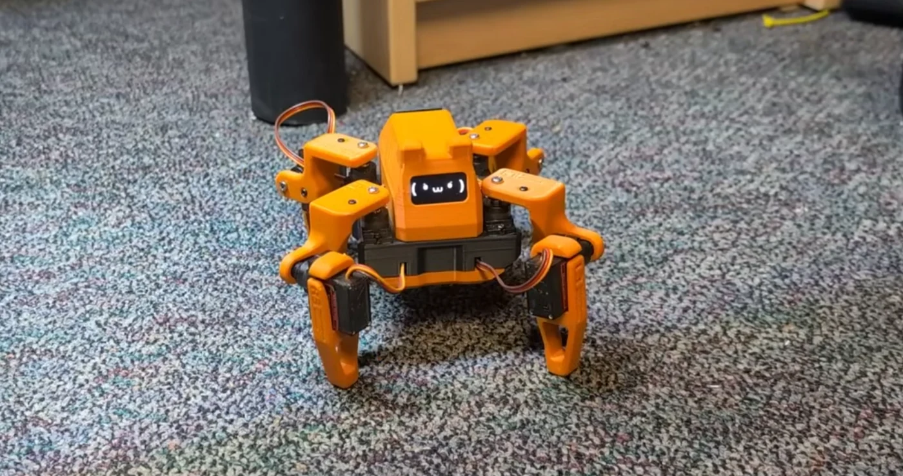

+++
title = "Sesame-robot 四足机器人教程工坊"
slug = "sesame-workshop"
categories = ["DIY"]
date = 2026-11-12T22:40:00+08:00
description = "把 Sesame-robot 的装配、接线和调试资料整理成中文教程，再把固件烧录与舵机测试放进浏览器。这是教程工坊的来由，也记录了我在原项目上补充的工作。"
keywords = ["Sesame-robot", "四足机器人", "ESP32", "DIY", "Web Serial"]
clearReading = true
showSocial = false
showPagination = true
showTags = true
showDate = true
+++

最近我把复刻Sesame-robot的实践整理成了一套易上手的中文教程。直接访问[Sesame-robot 四足机器人教程工坊](/diy/sesame/)即可开始，完成从材料准备、焊接与线路连接、组装、烧录测试整个流程，无需再安装其他任何软件，直接在网页完成整个的制作。

<!--more-->

## 先说原项目

[Sesame-robot](https://github.com/dorianborian/sesame-robot) 是 dorianborian 开源的四足机器人项目。四条腿，每条腿两个舵机，机身前面还有一块用来显示表情的 OLED 屏幕。外壳和关节可以通过 3D 打印制作，原仓库里有模型、装配资料和固件代码。

*上图是原项目的成品参考，图片来自原作者。*

机器人本身的设计来自这个项目。我沿用它的结构和模型，围绕 LOLIN S2 Mini（ESP32-S2）整理制作步骤，再补充中文说明、接线对照和网页工具。如果想了解原始设计、查看源码，建议先收藏原仓库；跟着本站教程做时，也要注意主控型号，别把其他 ESP32 开发板的引脚直接套过来。

## 我在复刻中补了什么

有了模型和代码，接下来就是很多具体的小事：打印件怎么装，线从哪里走，图里的关节对应哪一路舵机，以及什么时候该停下来做一次测试。我把物料、接线图、装配照片和参考视频按制作顺序重新放了一遍，尽量让每一步都能找到对应的实物参照。

接线和关节编号是我单独整理的一部分。比如教程里的 S0–S7 是固件通道，R1、R2、L1、L2 等是关节名称，开发板上又有 GPIO 编号。只看其中一套编号，很容易对错位置。现在接线说明和测试界面会把它们一起显示；其中 S4 对应 R4、S5 对应 R3，也专门保留了提示。

装配步骤则按调试需要来安排。先用测试固件逐个检查舵机、完成回中，再固定关节摇臂，进入正式程序的姿态核对和零位微调。这样发现某条腿方向不对时，至少可以先分清是通道接错、摇臂位置不对，还是需要调整偏移，不必把所有问题混在一起排查。

网页工作台也是为这些步骤做的。第五章放测试固件烧录和单舵机测试，第六章放正式固件烧录与校准。读到“烧录正式固件”，下面就是操作区，不用离开教程再去找入口。我还给舵机测试加了三维行程参考，方便看选中关节的转动方向；不过图上转了多少度只是目标角度，实物是否转到位、有没有碰到其他零件，仍然要自己观察。

## 教程放在这里，边看边做

**[进入 Sesame-robot 四足机器人教程工坊](/diy/sesame/)**

打开工坊后，按左侧章节顺序边看边做即可。材料清单、打印文件和参考视频都在对应步骤里，图片可以点击放大。完成一项就勾选记录，下次用同一个浏览器打开，还能接着看。

做到烧录和舵机测试时，用电脑上的 Chrome 或 Edge 打开页面，通过 USB 数据线连接 S2 Mini，按步骤里的工作台提示操作即可。手机也可以查阅教程，但烧录和串口测试需要在电脑上完成。
